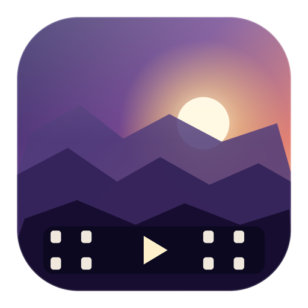
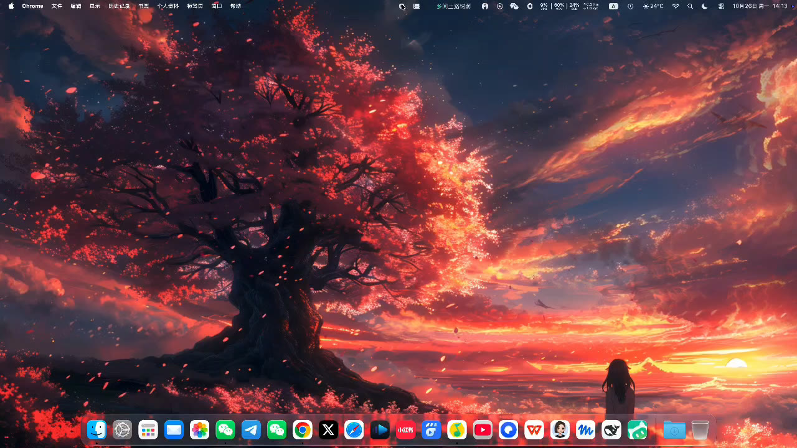

# DynamicWallpaper

[](LICENSE)
[]()
[](https://github.com/XXKG2026/DynamicWallpaper/releases/latest)

Plays any MP4 video full-screen on your macOS desktop as a live wallpaper. Native Swift + AppKit, no third-party dependencies, under 1 MB.

> 把任意 MP4 视频铺满 macOS 桌面，作为动态壁纸播放。原生 Swift + AppKit 实现，无第三方依赖。
> [中文说明](README.md)

<p align="center">
  
</p>

<p align="center">
  
</p>

<p align="center"><sub>The video fills the desktop; icons and all app windows render normally on top</sub></p>

---

## Why this exists

macOS only supports static images in System Settings — there is no video wallpaper option. This tool works by creating a window at a special level:

| Level | Value | Contents |
|---|---|---|
| Desktop wallpaper image | -2147483623 | System static wallpaper |
| **Video window** | **-2147483613** | ← this project |
| Desktop icons | -2147483603 | Files on your desktop |
| Normal windows | 0 | Everything else |

The video window sits between the wallpaper and the desktop icons, so:

- Visually it *is* the desktop background — **icons and all app windows render normally on top of it**
- `ignoresMouseEvents = true` → clicks pass straight through, nothing is blocked
- `canJoinAllSpaces` + `stationary` → the video survives Space switching and full-screen apps
- One window per display on multi-monitor setups

## Features

- Plays any MP4 / MOV / M4V, hardware-decoded and looped
- Menu bar control, no Dock icon
- Quick video switching, random rotation within a folder
- Launch at login (LaunchAgent)
- Single-instance lock, never runs twice
- App icon generated programmatically with CoreGraphics

## Requirements

- macOS 11.0+ (Big Sur or later)
- Xcode Command Line Tools (`xcode-select --install`)

## Download

Don't want to build it yourself? Grab the prebuilt package (universal binary, runs natively on both Apple Silicon and Intel):

**https://github.com/XXKG2026/DynamicWallpaper/releases/latest**

Download `DynamicWallpaper-*-macos.zip`, then:

```bash
unzip DynamicWallpaper-v1.0.0-macos.zip -d /Applications
xattr -cr /Applications/DynamicWallpaper.app
```

The app is ad-hoc signed and not notarized by Apple. On first launch use right-click → Open, or run the `xattr -cr` command above.

## Build from source

```bash
git clone https://github.com/XXKG2026/DynamicWallpaper.git
cd DynamicWallpaper
./build.sh
```

`build.sh` will: compile → generate icon → assemble the `.app` bundle → ad-hoc sign → install to `/Applications` → register with LaunchServices.

By default it builds for the host architecture only. To produce a universal binary (Apple Silicon + Intel), which is what the release packages use:

```bash
UNIVERSAL=1 ./build.sh
```

## Usage

Drop your videos into `~/Movies/动态壁纸/` (or any folder), then:

```bash
./start.sh                      # start, random rotation
./start.sh "/path/to/x.mp4"     # play a specific video
./start.sh --dir ~/Movies/xxx   # use a specific folder
./start.sh --list               # list available videos
./start.sh --status             # check if it's running
./start.sh --stop               # stop
```

You can also just double-click **动态壁纸** in `/Applications`.

### Menu bar

A film-strip icon appears in the menu bar once running:

| Item | Description |
|---|---|
| Current: xxx.mp4 | Shows the file being played |
| Switch video ▸ | Video list, current one checked |
| Next video | Advance manually |
| Browse other videos… | Pick a file from anywhere |
| Pause / Resume | Stop or resume rendering |
| Rotate every 30s | Toggle random rotation |
| Launch at login | Toggle the LaunchAgent |
| Quit | Exit |

### Command-line arguments

| Argument | Description |
|---|---|
| `<path>` | Play the given file |
| `--dir <path>` | Use the given video folder |
| `--shuffle` | Rotate to a random video every 30s |
| `--debug` | Print playback progress to stderr every 2s |

## Performance

4K / high-frame-rate decoding is expensive. If your Mac runs hot or drains battery, transcode a lighter copy:

```bash
mkdir -p ~/Movies/wallpapers-1080p
for f in ~/Movies/动态壁纸/*.mp4; do
  ffmpeg -i "$f" -vf scale=1920:-2 -r 30 -c:v libx264 -crf 23 -an \
    ~/Movies/wallpapers-1080p/"$(basename "$f")"
done
```

Then `./start.sh --dir ~/Movies/wallpapers-1080p --shuffle`.

## Launch at login

Ticking "Launch at login" in the menu bar writes:

```
~/Library/LaunchAgents/com.local.dynamicwallpaper.autostart.plist
```

Untick to delete and unload it.

If your terminal session has no GUI session credentials (`launchctl bootstrap` fails with `Input/output error`), run this manually in Terminal.app:

```bash
launchctl bootstrap gui/$(id -u) ~/Library/LaunchAgents/com.local.dynamicwallpaper.autostart.plist
```

Or just wait for the next login — launchd scans that directory automatically.

## FAQ

**`start.sh` arguments are ignored / the same video always plays**

On macOS 26+, `open -a ... --args` silently drops `--args`; the app only receives its own path (verified: the `-a` path form, `-b` bundle-id form, `-n`, and `--dir=x` all fail).

This project works around it by writing the arguments to a config file first, then launching with `open -a`:

```json
// ~/Library/Application Support/macos-video-wallpaper/config.json
{ "file": "/path/to/x.mp4", "dir": "~/Movies/动态壁纸", "shuffle": true }
```

Don't revert to `open --args`, and don't switch to running the binary under `nohup` — a process started that way gets reaped along with its parent's process group. It looks like it started, then silently disappears after a few dozen seconds. `open -a` hands the process to launchd, which is what keeps it alive.

**"Cannot verify the developer" on first launch**

The app is ad-hoc signed and not notarized by Apple. Right-click → Open, or:

```bash
xattr -cr /Applications/DynamicWallpaper.app
```

**No video on the desktop**

Check whether an instance is running: `./start.sh --status`.
Launch with `--debug` to see playback progress and `timeControlStatus` directly.

**Process is running but nothing shows**

Make sure the video is H.264 / HEVC. Check with `ffprobe`:

```bash
ffprobe -show_entries stream=codec_name,width,height "your.mp4"
```

## As an AI Agent skill

The repo also ships an installable Skill so an AI assistant can handle "set this video as my wallpaper" in one sentence:

```bash
./make-skill.sh          # produces dist/macos-video-wallpaper.zip
```

Unzip it into `~/.workbuddy-ai/skills/`. The skill compiles and installs the app, lists available videos, and starts playback.

`skill/` only holds `SKILL.md` and `scripts/`; the app source is reused from the repo root and copied in by `make-skill.sh` at packaging time — so the same code never lives in two places where one copy can drift.

## Releases

Tagging a version builds and publishes automatically via GitHub Actions:

```bash
git tag v1.0.0
git push origin v1.0.0
```

The workflow compiles a universal binary (arm64 + x86_64), zips the `.app` with `ditto`, bundles the skill, and attaches both to a GitHub Release. You can also trigger it manually from the Actions tab with a custom tag.

## Project structure

```
.
├── DynamicWallpaper.swift   # main program: window level, player, menu bar
├── makeicon.swift           # icon generation (CoreGraphics, procedural)
├── Info.plist               # bundle configuration
├── build.sh                 # compile + bundle + install
├── start.sh                 # start / stop / status
├── make-skill.sh            # produce the distributable skill zip
├── skill/                   # skill definition and scripts (source injected at pack time)
│   ├── SKILL.md
│   └── scripts/
├── .github/workflows/       # release automation
├── docs/icon.png            # icon used by the README
└── LICENSE
```

Build outputs (`DynamicWallpaper`, `*.app`, `AppIcon.icns`, `dist/`, `skill/assets/`, etc.) are listed in `.gitignore` and generated by the scripts.

## Notes

- No video assets are bundled. Use footage you have the rights to.
- The app is ad-hoc signed, suitable for local use. Distributing to others requires your own developer certificate and notarization.

## License

[MIT](LICENSE)
